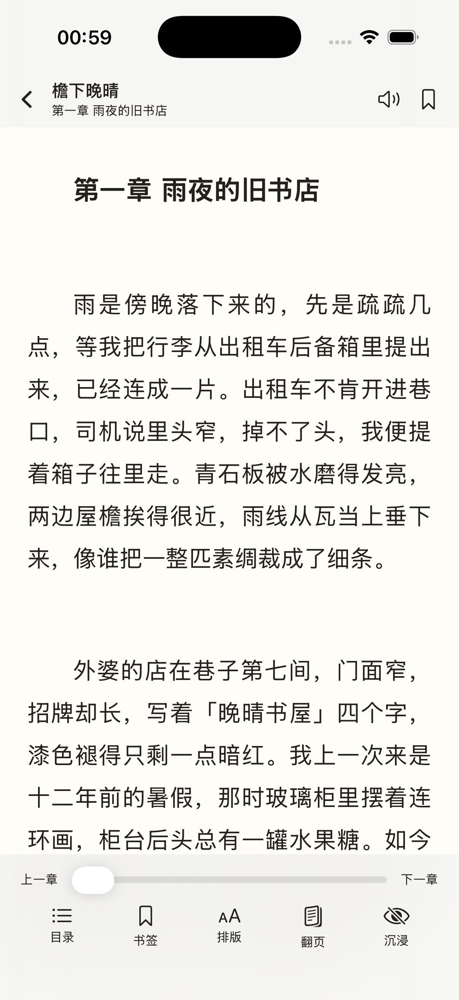

# iRead — 原生 iOS 小说阅读器

纯原生（SwiftUI + CoreText）的中文小说阅读器，支持**看**和**听**，完全离线。内置 Piper 中文神经语音模型，音质接近真人。




## 功能

### 看
- TXT 导入（UTF-8 / GBK 自动识别），文件仅存本机 `Documents/Books/`
- 章节自动识别：`第X章 / 卷X / Chapter N / 序章 / 楔子 / 尾声` 等目录规则，识别失败按固定长度兜底切分
- **两种阅读方式**：上下滑动（网页式连续滚动，默认）/ 左右翻页，阅读页一键切换
- **滑动模式跨章无缝**：多章堆叠在同一 `UIScrollView` 里，滑到章末直接接下一章标题，不会「一章到底就停」；前插章节时等量补偿 `contentOffset`，视觉不跳动
- CoreText 原生渲染（不走 WebView），中文避头尾（标点不出现在行首）、两端对齐、首行缩进
- 排版可调：字号 14–36、行距、段间距、四向边距、粗体；四套主题（纸张 / 羊皮纸 / 护眼 / 夜间）
- 翻页：滑动 / 点击翻页，slide / fade / none 三种动效
- 书架：网格 / 列表、搜索、置顶、已读标记、重命名、进度百分比、阅读进度记忆（滑动模式记到章内位置）
- 书签：任意页添加，可跳转、左滑删除

### 听（三种音色，全部离线）
| 音色 | 引擎 | 模型 | 说明 |
|---|---|---|---|
| 女声「花颜」 | Piper VITS（内置） | `zh_CN-huayan-medium` 63MB | 音色自然，中位基频约 214Hz |
| 男声「超文」 | Piper VITS（内置） | `zh_CN-chaowen-medium` 63MB | 青年男声，中位基频约 160Hz |
| 粤语 | 系统 `AVSpeechSynthesisVoice` | `yue-HK` Sinji | 用粤语读音念书面中文，学粤语用 |

- 两个内置模型都经 sherpa-onnx 在本机 CPU 推理，22050Hz；首次加载约 0.5–0.7 秒，之后常驻，切音色不重复加载
- 合成速度约为实时的 6–14 倍，按句流水线合成：第 N 句在播时第 N+1 句已在合成
- **标点停顿**：Piper 逐句独立合成、拼接后本来没有间隙，因此每句结束会按句尾标点补一段静音
  （`。`0.42s、`！？`0.50s、`…`0.55s、`；`0.30s、`：`0.22s、`，、`0.18s、换行 0.55s）
- **男声的额外处理**：超文模型走词典音素化，词典里没有任何标点，逗号会被直接丢弃。
  因此男声朗读时会把逗号/顿号也作为断句点（女声走 espeak 能自己处理标点，不切这么碎）
- 阅读页顶部喇叭按钮或书架长按「听书」进入；**滑动模式按段朗读并自动向下滚动**，翻页模式读完自动翻页，均跨章连续
- 沉浸模式下方有迷你听书条：播放 / 暂停 / 停止；锁屏与后台可继续播放（`UIBackgroundModes: audio`）
- 语速可调（x0.7 – x1.5），中断处理：来电自动暂停、拔耳机自动暂停

### 内置内容
三本**原创**演示小说（共 21 章约 1.4 万字）：《檐下晚晴》（都市温情）、《潮汐档案馆》（近未来科幻）、《青灯渡异录》（古典志怪）。首次启动自动灌入书架，可删除。

> 本项目不含网络书源，不内置任何第三方版权作品。

## 工程结构

```
iRead/
  App/          iReadApp、ContentView（Tab：书架 / 设置）
  Models/       Models（Book/Chapter/Bookmark/主题/阅读方式/音色档位）、ReaderSettings
  Services/     TextParser（编码+分章）、LibraryStore（书库）、
                BookContent（章节定位）、Paginator（CoreText 分页）、
                PageCanvas（分页绘制）、ChapterScroller（连续滚动排版与滚动容器）、
                PiperSynthesizer（sherpa-onnx 本地语音封装，双模型）、
                SpeechService（听书调度：双引擎 + 逐句流水线 + 标点停顿）、
                SampleBooks（内置原创示例）
  Views/        Bookshelf、Import、Reader、ChapterList、ReaderSettings、Bookmarks、Settings
Vendor/
  SherpaOnnxC.xcframework          sherpa-onnx v1.13.8（含 onnxruntime，动态框架）
  piper/                           语音资源根目录（folder reference，保留目录结构）
    huayan/                        zh_CN-huayan-medium.onnx + tokens.txt（女声，走 espeak）
    chaowen/                       zh_CN-chaowen-medium.onnx + tokens.txt + lexicon.txt
                                   + phone/number/date.fst（男声，走词典）
    espeak-ng-data/                cmn/en 词典（仅女声用，18MB → 3.2MB）
Support/
  Info.plist    UIBackgroundModes=audio（与生成的 Info.plist 合并）
docs/screenshots/      运行截图
```

### 关于语音模型的版本选择

`sherpa-onnx` 从 **v2.0.0** 起移除了 espeak 前端（`data_dir` 标注 `@deprecated Ignored since v2.0.0`），
而 Piper 中文模型必须靠 espeak 做 `cmn` 音素化，因此固定使用 **v1.13.8**。

iOS 包必须选 `ios-shared-onnxruntime-static` 这一款：`ios-static` 变体不含 onnxruntime，
链接时会报 `Undefined symbols: _OrtGetApiBase`。前者是动态框架、onnxruntime 已静态内置，
需要以 **Embed & Sign** 方式嵌入 App。

### 语音模型的三个坑（都实测踩过）

1. **int8 / fp16 量化版不能用**。`chaowen-int8` 会静默卡死，`chaowen-fp16` 直接崩：
   ```
   Ort::Exception: Type (tensor(float16)) of output arg does not match expected type (tensor(float))
   ```
   sherpa-onnx iOS 的 onnxruntime 静态构建是纯 CPU fp32，只认原始 fp32 模型。
2. **词典模型和 espeak 模型不能共用一套配置**。C API 明确规定 `lexicon` 在提供 `data_dir` 时被忽略，
   配错会在 `SherpaOnnxCreateOfflineTts` 里抛 C++ 异常直接 abort（不是返回 nil，无法用 `guard` 兜住）。
   花颜走 `data_dir`，超文走 `lexicon`。
3. **iOS 没有任何中文男声**。实测 `AVSpeechSynthesisVoice.speechVoices()` 里中文只有
   `zh-CN Tingting`、`zh-TW Meijia`、`yue-HK Sinji`，全是女声。
   所以「男声」必须靠内置模型，不能指望系统语音。

## 构建与运行

要求：Xcode 26.5+（iOS 26.5 SDK）、iOS 17.0+ 真机或模拟器。

```bash
# 模拟器
xcodebuild -project iRead.xcodeproj -scheme iRead \
  -destination 'platform=iOS Simulator,name=iPhone 17' build

# 真机一键构建 + 签名 + 安装 + 启动
./scripts/install-device.sh
```

真机签名使用 team `8VM4LPD9YP`，`xcodebuild` 需带 `-allowProvisioningUpdates` 自动生成描述文件。

## 调试参数（仅自动化截图/自检用，正常使用不涉及）

- `--debug-reader`：启动后直接打开第一本书
- `--debug-settings`：启动后切到设置 Tab
- `--scroll` / `--page`：强制滑动 / 翻页阅读模式
- `--scroll-mid`：滑动模式直接定位到章中 45%
- `--scroll-end`：滑动模式定位到章末（验证跨章衔接）
- `--voice female|male|cantonese`：指定音色档位
- `--listen`：打开书后自动开始听书
- `--immersive`：进入沉浸模式（隐藏工具栏）
- `--night`：临时切夜间主题
- `--expand-prefs` / `--prefs-scroll-speech` / `--prefs-scroll-mode`：设置页展开并滚动到指定分区
- `--tts-selftest`：跑一遍本地语音自检，打印模型加载耗时、每句合成耗时、基频、标点静音长度、
  断句结果与播放链路是否走通（`--male-only` / `--female-only` 可只测单个模型）
- `--list-voices`：打印系统全部语音清单（确认中文男声/粤语是否真的存在）
