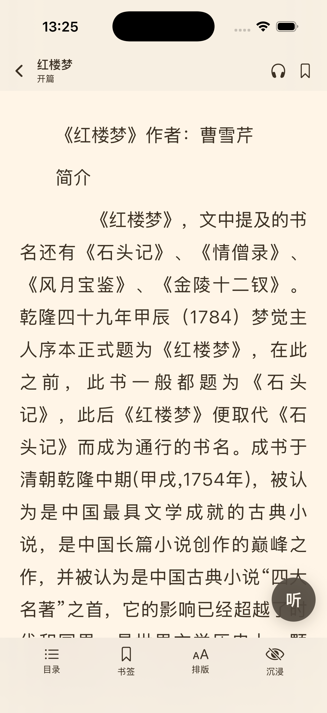
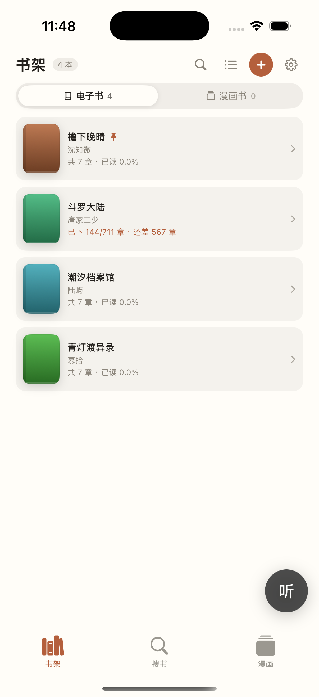
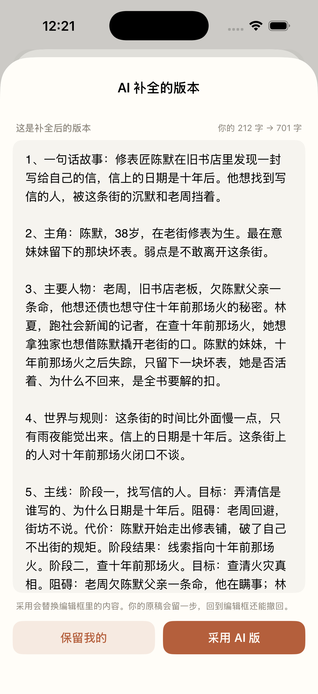
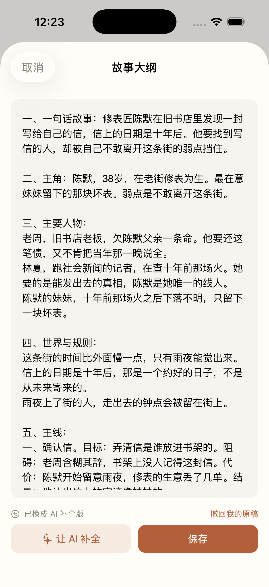

# iRead — 原生 iOS 小说阅读器

纯原生（SwiftUI + TextKit）的中文小说阅读器，支持**看**和**听**，阅读完全离线。内置 Piper 中文神经语音模型，音质接近真人。新增「搜书」功能：从内置书源在线搜索、下载到本机后离线阅读，阅读时没有 App 广告。另有独立的**漫画**模块：漫画搜索、按话缓存、图片阅读器，和文字书分开管理。

搜索已经收敛成**一个入口、五个频道**（书籍 / 漫画 / 音乐 / 动漫 / 视频）：书和漫画是「搜到 → 下到本机」，音乐和视频是「点一下就在线播」，音乐播过的会自动存一份到本机，下次不用再下。书架也跟着扩成**书 / 漫画 / 音乐 / 视频**四类，四类同表、按 `kind` 分流。

还多了一个**写作**模块：可以改写、分叉、续写正在看的那一章，也可以拿书架当口味参考从零起一本；长篇能一章一章连着写，写完逐章批注、再一次性按意见改；导出 TXT 直接投平台。**看是看，写是写** —— AI 产出只进写作稿，从不回写原书。

> **使用声明：仅供个人学习、禁止传播、禁止批量、看完即删、责任自担。**




## 功能

### 看
- TXT 导入（UTF-8 / GBK 自动识别），文件仅存本机 `Documents/Books/`
- 章节自动识别：`第X章 / 卷X / Chapter N / 序章 / 楔子 / 尾声` 等目录规则，识别失败按固定长度兜底切分
- **阅读方式只有一种：上下连续滑动**（网页式滚动），多章堆叠在同一 `UIScrollView` 里；跳章走菜单「目录」，阅读页没有上一章/下一章按钮
- 设置面板（番茄式底部抽屉，底栏第三项）：亮度 + 护眼、字号 + 粗体、背景色、间距/边距、常亮，全部一行一控；调字号时上半屏正文仍可见。**这一项叫「设置」不叫「排版」** —— 亮度、护眼、常亮都不是排版，叫排版等于把后几项藏进错名字底下
- **跨章无缝**：滑到章末直接接下一章标题，不会「一章到底就停」；前插章节时等量补偿 `contentOffset`，视觉不跳动
- TextKit 原生渲染（`UITextView`，不走 WebView），中文避头尾（标点不出现在行首）、两端对齐、首行缩进
- **选中就是系统选中**：长按出现放大镜、左右圆形手柄、可拖拽调整范围，复制 / 查询 / 翻译 / 朗读全在系统菜单里 —— 选中框和手感与系统完全一致，不是自绘的假选中
- 排版可调：字号 14–36、行距、段间距、四向边距、粗体；四套主题（纸张 / 羊皮纸 / 护眼 / 夜间）
- 书架：网格 / 列表、搜索、置顶、已读标记、重命名、进度百分比、阅读进度记忆（精确到章内位置）
- **全局设置只做一个齿轮**：书架右上角的 icon（不带文字、不占标签栏），点开以 sheet 弹出，管阅读偏好 / AI 写作 / 数据 / 关于；底部标签栏只有「书架 / 搜索 / 写作」三项（搜索页内部再分五个频道）。阅读页底栏那个「设置」是另一层，只调当前这本书的观感，不与它重复
- **不做书签**（2026-11-22 删除）：看网文是「一路往下追」，没有回头标记段落的习惯，所以底栏只留「目录 / 设置 / 沉浸」三项。上次读到哪由阅读进度自动记住（精确到章内位置），退出再进直接接上，不需要手动标记
- 听书：**同样只有一个入口** —— 阅读页右下的「听」球（沉浸模式下也在），点开就是播放器；顶栏那颗耳机图标已删，它和「听」球指向同一个界面。播放中那颗球会变成播放胶囊，暂停 / 继续 / 进度都在上面
- **阅读界面里就看得见下载进度**（2026-11-22）：顶栏章节名右侧标「已下 284/711」，目录页头部标「已下 56/711 章 · 还差 655 章」，底部直接给「继续下载剩余 N 章」—— 想确认这本下到哪、还差多少，不用退出阅读去下载页看
  - **目录列出还没下载的章**：向书源取一次完整目录（下载器有缓存就不再发请求），未下载的章以灰色 + 「未下载」标出，点一下弹「第 N 章还没下载」并可一键续传；打开目录前会把后台新下好的章节补进阅读器，不用退出重进
  - **打开目录就停在当前章**（2026-11-22）：不再从第 1 章列起，当前章落在「上面留一章」的位置并高亮，几百章的书不用再一路翻过去；标题允许两行，避免「（三）」「（四）」这种只差结尾的章节被截成一样

### 听（三种音色，全部离线）
| 音色 | 引擎 | 模型 | 说明 |
|---|---|---|---|
| 女声「花颜」 | Piper VITS（内置） | `zh_CN-huayan-medium` 63MB | 音色自然，中位基频约 214Hz |
| 男声「超文」 | Piper VITS（内置） | `zh_CN-chaowen-medium` 63MB | 青年男声，中位基频约 160Hz |
| 粤语 | 系统 `AVSpeechSynthesisVoice` | `yue-HK` Sinji | 用粤语读音念书面中文，学粤语用 |

- 两个内置模型都经 sherpa-onnx 在本机 CPU 推理，22050Hz；首次加载约 0.5–0.7 秒，之后常驻，切音色不重复加载
- 合成速度约为实时的 6–14 倍，按句流水线合成：第 N 句在播时第 N+1 句已在合成
- **标点停顿**：Piper 逐句独立合成、拼接后本来没有间隙，因此每句结束会按句尾标点补一段静音
  （`。`0.42s、`！？`0.50s、`…`0.55s、`；`0.30s、`：`0.22s、`，、`0.18s、换行 0.55s）
- **逗号也要停顿（两个模型都切）**：Piper 是逐句独立合成，句内标点本身不产生间隙 ——
  男声走词典，标点直接被丢弃；女声走 espeak 虽认标点，但生成时 `silence_scale` 只有 0.2，
  实测逗号处只剩约 60ms 自然换气，听不出停顿。因此两个音色都在逗号/顿号/冒号处切句
  （最短 4 字），靠句尾补静音拿到真实停顿：女声实测 60ms → 329ms
- 阅读页顶部喇叭按钮或书架长按「听书」进入；**按段朗读并自动向下滚动**，跨章连续
- **朗读变色**：正在读的那一句，字本身换成朗读色（不是加底色色块），自动跟随滚动，一眼看出读到哪
- **从这儿读**：长按选中任意文字 → 系统编辑菜单最前面就是「播放」，点它**立刻从选中位置出声**，不弹播放器（正文不被遮住，少一次多余跳转）；复制 / 查询 / 翻译等系统项照常可用。已去掉「点屏幕就开始朗读」：点击位置无法可靠对应到某一块文字，只有先选中才能确定要读哪句
- **续读**：朗读位置只由朗读本身推进 —— 停止后再次开播，从上一次读到的文字位置（段落开头）继续，**不看屏幕当前停在哪**。手动滑动浏览不会改变朗读位置；只有编辑菜单「播放」和「从本页听」会同步它
- **听书与阅读互不干扰**：跳章只挪阅读视口，**不会换朗读到那一章、也不会自动开播**，声音照旧念原来的地方；想改从这一章听，点跟读条上的「从本页听」
- **回到朗读位置**：正在听这本时把正文滑到别处看，跟随会自动停下（不再把页面拽回去）；此时底部浮出「回到朗读位置」，一点就回到**当前正在念的那一句**并恢复跟随。它只挪视口、不改朗读进度，也不会重读
- **边听边读**：播放器里点「边听边读」打开真正的阅读页，从朗读位置开始跟读；跟读条上的「返回」随时滚回正在朗读的那一句（和滑开时浮出的「回到朗读位置」是同一个动作）。跟读条自带「听书」入口，一键回到播放器调语速、换音色
- 沉浸模式下方有迷你听书条：播放 / 暂停 / 停止；锁屏与后台可继续播放（`UIBackgroundModes: audio`）
- 语速可调（0.4x – 4.0x，滑杆连续调节，变速不变调），中断处理：来电自动暂停、拔耳机自动暂停

### WiFi 传书
书架右上角「+」→「导入书籍」→「WiFi 传书」开启服务，App 内会显示一个局域网地址（含本次 6 位访问码）。
同一 WiFi 下的电脑/另一台手机用浏览器打开该地址，选 TXT 上传即自动进书架，支持一次选多本、UTF-8/GBK/UTF-16 编码、单本 60 MB 以内。
每次开启服务访问码随机生成，地址泄露也不会被别人误传；传完可在 App 内点「停止」。服务只在本机监听，不连互联网、不扫描其它设备，传书过程不需要外网。

> 传书时需要 iRead 保持在前台；切后台太久系统可能挂起本地服务。

### 搜书与下载（在线找书，离线阅读）
搜索页第一个频道「书籍」可从书源搜索书名，选中后把正文**下载到本机**加入书架，之后走和本地导入完全相同的离线阅读链路 —— 阅读本身不联网。

- **已移除番茄 / 七猫源**（2026-11-21）：七猫网页端只开放前若干章，后段要在七猫 App 内开通会员才给读；番茄重复条目多、章节接口经常挂住（实测单条 25s+ 不返回）。两者对「下载全本」帮助都很小，还会拖慢搜索与章节统计，已从内置书源里去掉。实现代码（`FanqieSource` / `QimaoSource`）保留，需要时把源条目加回 `SourceStore.fallbackSources` 即可。
- **内置公版书源**：殆知阁古籍（1.5 万+ 本经史子集、四大名著、诗词小说、中医典籍）。书目随 App 打包（本地即时搜索、无 API 限流），正文从 jsDelivr/raw CDN 下载，大陆可达。
- **内置笔趣阁源**（`bqg-92xs`，就爱文学）：纯静态 HTML 抓取的书源示例，规则见 `docs/sources/bqg-92xs.json`。站点域名易变，失效时可在书源管理页编辑 host 或导入新规则。
- **内置「阅读」共享书源包**（2026-11-21）：把社区流传的 941 条「阅读 3.0」书源跑了一遍转换器，只有规则能用 CSS 选择器表达的那部分能转（340 条），按站点去重后 314 条，联网三阶段实测（搜索 → 目录 → 正文）最终留下 **9 个稳定可用的静态站**，随 App 打包在 `iRead/Resources/sources_legado.json`。它们大多是笔趣阁同模板站，一本书在不同站点的可下章数差别很大（例如《剑来》在 00小说网 1093 章、其余几家 1311 章），正好用来比「哪个源能下全本」。正文/目录里常见的站点广告（最新网址、天才一秒记住、章节报错提示、「最新章节」区块）已在规则里清掉；站点的域名迁移也一并修正。
- **书源可导入/可编辑**：书源管理页支持粘贴或选择 JSON 导入自定义书源，内置源可禁用；规则格式见下方「书源规则格式」。
- **使用声明**：仅供个人学习、禁止传播、禁止批量、看完即删、责任自担。本项目自带内容均为公版/原创；第三方书源（含笔趣阁）仅提供抓取能力，内容来源由使用者自行判断并承担相应责任。该声明在书籍详情页与设置页常驻；搜书页首次进入时完整展示，搜索后收进顶栏的 ⓘ 按钮（点开即看），把屏幕让给结果列表。
- **边下边读**：点「下载全书」后书**立即进入书架**（占位），正文分批抓取、抓完一批写一批 —— 下几章就能先读几章，不必等整本下完。进度直接显示在书架封面与「下载任务」页，可随时**暂停 / 继续 / 取消**，取消保留已下章节。下载完成后自动跳到书架。
- **下载是单本队列**（2026-11-22）：同一时刻只下一本，其余排队显示「等待中」，前一本下完自动接手。小说一批本来就要并发抓 4 章，几本一起下只会互相抢带宽，每本进度都卡在个位数，还同时挂着好几个抓取循环 —— 一本一本反而更快出结果、内存也只有一个循环。**暂停**的书会直接退出循环、让出队列位置（等用户点「继续」再重新排队），所以暂停一本不会把整条队列冻住；漫画下载同理，整本串行、话内仍然 3 图并发，阅读器里点开某一话走的是插队路径，不受队列影响。

  

- **闪退也不丢下载进度**（2026-11-22）：队列状态和「已下到第几章」跟着书一起落盘（`library.json` 里的 `book.download`），重启后自动把没下完的接着下 —— 从断点续传，不重下前面的章节。以前这些只活在下载器内存里，闪退后书架上只剩一本半成品：既不知道总共多少章、也不知道该回哪个源，只能重新点「下载全书」整本重来。
  - **暂停会活过重启**：重启后仍在任务列表里显示「已暂停」，等你点继续，不会自己跑起来。
  - **能看出是不是全本**：书架列表显示「已下 443/711 章 · 还差 268 章」，详情页直接给「继续下载剩余 N 章」，不再出现「不知道下完没有」。
  - **自动查更新**：打开一本书时顺手核对一次目录（6 小时节流、非网络书不查），源站加了新章就自动接着下；书架长按也有「检查更新 / 继续下载还差 N 章」。
  - 省电上的取舍：只在**状态切换**（排队/开跑/暂停/完成/失败）时写一次状态，进度不单独写盘 —— 它跟着每批章节已有的那次 `library.json` 写入一起更新，所以恢复能力是零额外 I/O 换来的。

  
  


- **多书源并发搜索**：每个启用的书源各起一个任务同时搜，谁先回来谁先上屏；单源 12 秒超时，某个源挂掉或超时不会拖住其它源（结果按书源顺序稳定排列）。
- **结果直接标章节数**：每条结果在后台查目录并显示「可下 87/1279 章」「共 1312 章」这类规模，查询最多 3 并发、滚到哪查到哪，不会一次性把书源打满。「目录为空」（占位书/已下架）与「无可下载章」（有目录但一章正文都拿不到）分开标注。
- **同名书按源并列**：同名条目聚在同一区块，作者一致的标「同名书 · N 个源都有」，作者不同的提示「作者不同请核对」；可下章数最多的那条标「章节最多」，选源下载时一眼能比。
- **一键按章节数排序**：搜索结束后点右上角「章节最多」，结果按**可下章数**从多到少重排（组内也按章数排，同名书仍挨在一起）。排序是手动动作、只在搜索完成后可用：搜索过程中结果还在陆续回来，此时不重排。点下后立刻按已知章数排序，没查到的先沉底、查到就归位，顶部显示「正在统计章节…还剩 N 本」；单条请求 6 秒上限，即使某个源挂住也不会把整批拖死。
- **下不了的自动过滤**：目录为空、或确认一章正文都拿不到的条目默认隐藏，顶部显示「共 X 本可下载，已隐藏 Y 本」，点「显示全部」可回看被隐藏的条目。章节数查询失败（网络抖动 / 书源风控）只标「章数未知」并重试一次，不会把能下的书误删。
- **搜索框点别处就收键盘**：点结果区、点空白、往下一划都会收起键盘 —— 不用非得跑到键盘右下角点「搜索」。收起键盘不会清掉已输的关键词，想搜再点「搜索」或键盘上的搜索键。单手拿手机时这一步省得很明显。
- 批内并发抓章（4 并发），按章序回填保证正文不乱序；下载中的书点开照常阅读已落盘章节。

> 在线环节只有「搜索 + 下载」。正文落盘后，阅读/听书/排版全部离线，与本项目一贯的离线定位一致。

### 看漫画

书架顶部有四个分类胶囊「书 / 漫画 / 音乐 / 视频」，看哪种内容就切到哪一类；底部「搜索」标签页里的「漫画」频道是漫画的搜索入口，和「书籍」频道互不相干 —— 两类源的输入、结果、阅读器都不同，混在一个搜索框里每次都会白跑一半源。

- **共用一张表，按 `kind` 分流**：漫画也是 `library.json` 里的一条，`kind = "comic"`。备份、搜索、进度、置顶这些逻辑不必各写一份；书源同理，`NovelSource.media = "comic"`，`enabledSources` 自动把漫画源排除在「搜书」之外
- **存储**：每本漫画一个 `<uuid>.comic/` 目录，`meta.json` 记章节与每页的宽高/是否已落盘，图片按 `c<话号>/001.jpg` 存（几百话 × 几十页塞进 `library.json` 会把书架索引撑到几 MB）
- **按话原子下载**：一话下完才写 meta —— 缺几页比整话没下更难受。中断后只补没落盘的那几页，断点续传；3 张图并发、完成一张补一张，结果按下标回填保证页码不乱。阅读器和「缓存全部」共用同一条下载路径，不会下出两种残缺状态
- **阅读器先只做竖滑**：中文漫画里条漫占大半，左右翻会把一条长图切成几十屏、翻得人晕。图片用 `UIImage(contentsOfFile:)` 懒解码，滚出屏幕由 SwiftUI 回收；点画面收起/展开工具栏，底部可切上一话/下一话
- **缓存一眼可见**：书架封面角标「已缓存 x/总话数」，详情页「已缓存 x/y 话 · N 页」，章节 chip 带下载图标
- **本地导入**：书架的 `+` 选多张图片 → 统一转 JPEG、长边压到 2000 → 生成一本漫画，全程不联网
- **内置漫画源只有 MangaDex**：国内能直连的中文漫画站基本都上了 JS 动态渲染或签名校验，纯规则抓不动（baozimh / copymanga / manhuagui / mangabz / dm9 实测全部不可用）。MangaDex 是公开 API，优先取简中/繁体译本，没有中文时回退全语言；第三方漫画站可以导入 JSON 规则（`media: "comic"`，`content.list` 填图片选择器）
- **内置绘本源 Book Dash**（`builtin-bookdash`）：全部 CC BY 4.0，整本内页大图直接给，免注册、境内可连。绘本的内页本来就是图片，所以直接复用漫画那套「按话缓存 + 图片阅读器」，一本书就是一话，不需要另写 PDF 渲染器。书目走 WordPress REST（`/wp-json/wp/v2/books`），只取英文（`languages=621`）和无字绘本（`643`）—— Book Dash 同一个故事有十几种南非语言译本，最新上传的往往是文达语、聪加语这类读不了的版本，不过滤的话首页全是它
- **绘本页解析踩过两次改版**：老页面内页图叫 `*_interior_spreads_3.jpg`，还带 428w/768w 尺寸变体；2026-11 改成在 `read-book` 弹层里排一串 `<a href="原图">`，`data-src` 上只是懒加载缩略图。现在**优先认新结构**（`<a href>` 就是原图，DOM 顺序就是页序，不用再去尺寸后缀），旧结构留作兜底 —— 只认一种的话，站点一改版就静默返回 0 页，用户看到的是空白阅读器
- **两个实测踩到的坑**：MangaDex 的 edge 对「像浏览器」的 UA 会回一个 JS 校验页（正文是 HTML，JSON 解析必然失败）；它的图床 `*.mangadex.network` 更隐蔽 —— 带 Safari UA 时不报错也不挑战，只对开头几张之后的请求直接回 **404**，看起来特别像「图源不全」。两处都必须用可识别的自定义 UA
- **使用声明**：漫画源只提供抓取能力，内容版权归原作者与出版方，请自行确认合法性、勿传播。


### 听音乐（在线播，播过就存下来）

搜索页第三个频道。曲库是开源社区 **ccMixter**（Creative Commons 混音，免注册、公开 JSON API、mp3 直链，境内实测可连）；Jamendo 留了入口，填了免费 `client_id` 就一起搜，没填不占界面。

- **点一下就在线播**，同时把整首存到 `Documents/Music/Cache/<sha256前32位>.mp3`，索引在 `Documents/Music/library.json`。下次再点同一首直接读本地文件，不再走网络 —— 需求里的「自动保存，下次不用额外下载」就是这条
- **播过即入库**：搜到的歌不用点收藏也会进「我的音乐」，否则下次想再听同一首还得重搜一遍。收藏只是再加一层标记
- **必须「先下后播」而不是边下边播**：ccMixter 的音频直链做了防盗链，请求头必须带**带结尾斜杠**的来源页（`Referer: https://ccmixter.org/`），不带或写成 `https://ccmixter.org` 一律 **403**；`Origin` 单独加也没用，UA 无所谓。而 `AVPlayer` 发不出自定义请求头，直连必然 403 —— 所以播放路径统一成「先下到本地，再播本地文件」。一首 mp3 通常 1–9 MB，实测 9.2 MB 的曲子 8 秒下完，期间播放器显示「首次播放，正在下载 xx%（存好自动开始）」
- **下载成功要验内容**：403 的响应体是 **10 字节 HTML**，`URLSession` 照样回调「下载成功」。所以下载器会同时查 HTTP 状态码、`Content-Type`（`text/html` 直接判失败）、文件大小（<8 KB 判失败）和文件头（`ID3` / MPEG 帧同步 / `ftyp` / `FLAC`）。校验不过就删文件、不写 `cachedFile`，界面显示「缓存失败」。老版本已经把 10 字节错误页当成 mp3 存进来的，启动时自愈一次（<64 KB 的缓存连同索引标记一起清掉）
- **播放器是全局单例**：切标签、进阅读器都不停；播放器 sheet 挂在根视图上（搜索结果、书架、迷你条都只是把 `wantsPlayerSheet` 置 true），不会因为某个子视图被销毁而掉。开音乐前会先停掉听书朗读 —— 同一时刻只该有一个在出声
- 锁屏 / 控制中心支持播放、暂停、上一首、下一首、拖进度（`MPRemoteCommandCenter` + `MPNowPlayingInfoCenter`），后台继续播
- **程序化封面**：开源曲库大多没有专辑图，用 FNV-1a 由曲目 id 算一个稳定色相 + 首字母画一张。不能用 `hashValue` —— 它每次启动都变，同一首歌的颜色会跟着变
- 落盘后顺手读一次真实时长补进索引：曲库给的时长经常是空的，列表里全是 `--:--`

### 看动漫 / 视频（在线播，可下载）

搜索页的第四、第五个频道。两类只在检索源上不同，列表和播放器完全共用。

- **视频走 NASA 影像库**（`images-api.nasa.gov`，公共领域）：搜主题词拿片单，封面取 `~medium.jpg`，直链是 `~mobile.mp4`。实测 228 秒的正片能正常解码、时间在走
- **动漫是内置片单**：Blender 基金会的开源电影（Big Buck Bunny / Sintel / Tears of Steel 等）。只收 AVPlayer 真能播的 mp4 —— `download.blender.org` 上大量是 mkv/zip，下下来也只能干瞪眼
- **在线播放为主，想留着就下载**：种子直链下载走 `URLSessionDownloadTask`（几百 MB 不进内存），进度按 `video:<id>` 暴露；下载同样要过文件头校验（`ftyp` / Matroska / `RIFF` / MPEG-TS），避免把错误页存成 mp4
- **m3u8 不提供下载**：HLS 是切片清单，按单文件存下来播不了，所以列表里对 m3u8 隐藏下载按钮，但**仍然可以在线播**
- **接着上次看**：进度按 `秒/总时长` 写回 `Documents/Video/library.json`，书架卡片底部有进度条；再次打开时等 `readyToPlay` 再 seek（太早 seek 会被丢弃）
- **支持自己加直链**：右上角「+」填标题 + `mp4/m3u8` 地址，直接进「视频」书架

> 音乐和视频都是「在线看/听」，落盘只是为了下次不用再下；书架里那两类可以随时删，不影响别的数据。

### AI 写作（看是看，写是写）

有些书的设定合胃口、写法不对味。这一块就是让人自己下场：改写看不过去的那一章，或者把故事往别的方向推一章。**写作是底部第四个标签，独立数据、独立编辑器**，书架里的书是别人写的成品，写作里的是自己（和 AI）的草稿，两者不共用一张表。

#### 两个入口

**在阅读页**：顶栏右侧一颗「✨ AI」胶囊。不动原书一个字，生成结果存进「写作」。三个动作：

| 动作 | 给 AI 的交代 |
|---|---|
| 改写本章 | 剧情、人物、节点都不变，重写文笔与节奏 |
| 换个走向 | 从本章的转折点分叉，往下另走一条路 |
| 接着写 | 从本章结尾往后写一章（会带上上一章的结尾，好接上语气） |

下面还能补一句「这一版想怎么改」（更紧凑 / 文笔再冷一点 / 多写细节 / 对白多一点 / 别改结尾），空着也能跑。

**在写作页**：新建一本，三种起头方式 ——

- **重构底本**：选一本书架里的文字书，保留人物与设定，换一套写法重写
- **续写底本**：从底本的某一章之后接着写
- **全新创作**：不挂底本，只借用书架的题材口味

选完底本，方向那一栏自己写（比如「都市悬疑，节奏快一点」），也有题材胶囊可点。之后每章一次「让 AI 写第 N 章」，会把最近几章（编辑器底部写明「约 N 字」）一起发过去 —— 不然人物名和上一章的钩子会丢。

#### 几条设计取舍

- **大纲是用户的，AI 只补不换**：编辑框里已经有字时，按钮从「让 AI 起草」变成「让 AI 补全」，发给模型的指令变成「人名、身份、关系、事件顺序、世界规则一律照用，写到的句子尽量照抄，只补空的段」；产出也不直接落回编辑框，先进预览，点「采用」才替换，替换后还留一步「撤回我的原稿」。原因很直白：用户自己写的那几行才是他的故事，模型一晚上能写出十份不一样的大纲，但只有一份是他想要的
- **草稿一本一个 JSON**（`Documents/Writing/<uuid>.json`），不并进 `library.json`。写作是高频小改、每 600ms 防抖存一次，塞进整个书库索引里等于每次保存都重写一遍所有书；反过来说，删底本也不该连带删稿子
- **书架只贡献「书名」当口味**：新建时把书架上的书名清单发给模型（最多 12 本，在读的排前面），让它知道这人平时看什么，正文一概不发。真正发正文的只有用户在阅读页/新建页**明确选中的那一章**，界面上有单独一行写清楚。这些书名不是「仅供参考」：模型要按这个口味写同类 —— 书架全是玄幻就写玄幻的升级夺宝，别偷换成别的类型，也别替读者「拔高立意」
- **API Key 只进 Keychain**（`kSecClassGenericPassword`），不写 `UserDefaults` —— 偏好设置会被备份、导出、随手截图，Key 不该跟着走
- **本地模型不用 Key**：地址是 `127.0.0.1` / `localhost` / `192.168.` / `10.` / `172.` 开头时不要求填 Key（Ollama、LM Studio 默认没鉴权），同时提示「正文不会离开你的网络」。用自己的网关也一样，`http://127.0.0.1:8328/v1` 直接能跑
- **只接 OpenAI 兼容协议**，不绑厂商：`POST {baseURL}/chat/completions` + `stream: true`，逐行读 `data:`。DeepSeek / 通义 / Kimi / OpenAI / Ollama 都是这个口，换服务商只改地址和模型名
- **「停止」是真掐连接**：请求挂在 `Task` 上，点停止就 `cancel()`，`URLSession.bytes` 的序列随之中断，不会在后台把剩下几千字写完再白烧一遍额度
- **推理模型的思维链不显示，但要拿来报进度**：网关先吐 `reasoning_content` 再吐正文，写小说的思路会剧透、也没有阅读价值，所以正文区只渲染 `content`；但思维链的字数被用来驱动「正在构思（已想 1,240 字）…」，否则开头几十秒界面一片静止，看着像卡死
- **生成请求打包成一个值再弹 sheet**：`headline / detail / messages` 分几个 `@State` 逐个赋值时，sheet 会先渲染、读到半截状态，表现为「面板空白 + 这次没写成」。改成 `GenerationRequest: Identifiable` + `.sheet(item:)`，一次状态跃迁
- **不是 agent，也不是对话**：每次生成就是「固定 prompt 模板 + 拼好的上下文 → 一次 `/chat/completions` 请求 → 出完就停」，没有工具调用、没有自我反思、没有多轮累积。点「再写一版」是重新发一次同样的请求（换个随机结果），不是让模型看着上一版改。理由很实际：写小说最怕模型自己发挥跑偏，而 agent 那套「先规划 → 自检 → 不合格重写」会把 token 和等待时间翻几倍，换来的稳定性目前还不值

#### 导出 TXT

编辑器右上角菜单 →「导出 TXT」，走系统分享面板，可以存文件、发微信、传到别的 App。格式刻意做得很朴素：

```
第一章 门缝里的信

正文第一段……

正文第二段……
```

**只写「章节标题 + 正文」，书名不写进文件里** —— 起点、番茄这类平台上传时书名、简介、分类都是单独填的字段，文件里再带一遍反而要手动删。

#### 连写：上百章的流水线

单章一次调用解决不了「写一百章」——不是模型不行，是没人能盯着一百次点击。编辑器底部那个「连写」按钮就是干这个的：给个章数，它自己排章、写、审、不过就带问题局部重写（最多两次），通过才往下走。

**它不是 agent，是外层状态机。** 写几章、什么时候停、失败怎么办，全由 App 的代码决定；模型只在两个点上被调用：写正文、审稿。原因是长任务必须可控——一百章要跑几个小时，中途一定会限流、会被系统挂起，只有外层掌握节奏才做得到「一章一落盘、随时能停、停在哪下次从哪接、花多少钱可算」。让模型自己决定「再写五章吧」，跑到第 60 章才发现方向错了，代价太大。

三样东西撑着它不跑偏：

| 东西 | 作用 | 谁写的 |
|---|---|---|
| **故事大纲** | 主线、人物、世界规则、禁忌。每次生成都带上 | 用户写；空了才点「让 AI 起草」，写过就只让 AI 补 |
| **章纲** | 接下来每章一句话目标，比如「陈默在打烊前翻书，抖出一封写明七天后火灾的信」 | 开跑前一次排好，看得见方向 |
| **本章小结** | 40 字内，审查时顺手产出 | 模型，不额外花钱 |

小结这一条是长篇能写下去的关键。一百章正文三十万字，不可能每次都发过去；但审查那次调用本来就要读完整章，让它顺便交一句摘要几乎零成本。于是写第 80 章时，上下文是「大纲 + 前 79 章各一句摘要（约 3000 字）+ 最近两章正文」。比硬塞全文省得多，也比只给标题有用得多。

#### 大纲：你写的骨架，AI 只补不换

「让 AI 起草」只在**空大纲**时出现。编辑框里已经有字，按钮就变成「让 AI 补全」，做的事也换了：

- **骨架照用**：发给模型的指令是「人名、身份、关系、地点、已经定下的事件顺序、世界规则一律照用，不许改名换人；你写到的句子尽量照抄，只补空的段」。你写三行，回来还是那三行，只是补齐了人物表和主线阶段
- **产出不直接落回编辑框**：先进预览页，顶部写着「你的 212 字 → 701 字」，看完再决定。点「采用 AI 版」才替换，点「保留我的」一个字都不动
- **替换后留一步撤回**：编辑框下方挂一条「已换成 AI 补全版 · 撤回我的原稿」，点一下退回自己那版
- **类型跟着口味走，不替你定禁忌**：书架上是玄幻就写玄幻 —— 第 4 段要写清境界几步、往上走靠什么（功法、丹药、血脉、资源、师门），第 5 段每个阶段都要有实力跃迁和爽点（打脸、夺宝、越阶、扬名、护人）。「禁忌」只写你明确说过的；你没说就写「未限定」，不会自作主张禁掉重生、系统、打脸 —— 那正是玄幻读者要看的

以前这里只在提示词里加了句「不要推翻重写」，模型照样另起一套：用户写了三行自己的设定，回来发现被换成了另一个故事，等于白写。模型一晚上能写出十份不一样的大纲，但只有一份是他想要的 —— 所以改成「补完先给他看，采用才落地」。





每章的流程：

```
排章（每 N 章一次）
  → 写第 k 章（带大纲 / 摘要 / 最近正文 / 本章目标）
  → 审查（结构化结论：pass / issues / recap）
  → 不过：带 issues 局部重写 → 再审（最多两次）
  → 还不过：存为草稿、标出问题、停下（不无限重试烧额度）
  → 过了：落盘、消耗一条章纲、写第 k+1 章
```

重写是**局部修**不是整章重来：prompt 里明确要求「只动出问题的地方，其余逐字保留」。整章重写会带进新的门牌号、新的时间点，再和前面几十章撞一遍 —— 实测第一次跑两章，两次都是这么撞的（楼层、起火点、时间对不上）。所以系统提示里还加了一条狠的：**不许自己发明具体数字**（门牌、楼层、几点几分、几天几号），大纲和前文没写的就模糊处理。

审查只拦硬伤，不管文笔：人物名和身份对不上、已死的人又出现、跟大纲的世界规则冲突、时间线倒退、把上一章的事又写一遍、正文里冒出「以下是」「本章完」、整章没完成本章目标。文笔偏好不算硬伤——否则每章都会被退回重写。

几个边界：

- **屏幕常亮，但别手动锁屏**：开跑就把 `isIdleTimerDisabled` 置上，放着跑不会自动变暗（实测日志 `[iRead] screen awake on pipeline`）。这防的是「自动息屏」，防不住手动按侧边键锁屏或切到别的 App —— 那两种情况下 iOS 会冻结进程、掐断连接，只有**当前这一章**会丢，已经落盘的都在。进后台时还会申请约 30 秒额外时间（`beginBackgroundTask`），刚好快写完的那一章能保住；真被掐断时日志会说「被系统挂起」，而不是丢一句看不懂的「网络连接已断开」
- **常亮是一个全局开关，多个功能共用**。阅读页的「常亮」偏好、连写、单章生成面板都想让它亮，各写各的会互相顶掉（真实 case：连写在跑 → 进阅读页 → 阅读页按自己的偏好设回 false → 连写跟着息屏）。所以统一走 `ScreenAwake` 登记：谁要用就 `begin`，用完 `end`，只要还有人举着手就一直亮
- **速度取决于模型**：带推理的模型一章 3–5 分钟（实测 `deepseek-v4.1-flash`），一百章就是大半天到一晚上；写作这类任务用不带推理的模型（如 `deepseek-chat`）快得多，也够用。真跑长篇建议按 20 章一批，跑完看一眼方向再继续
- **一章一落盘**：写完一章立刻写 JSON，被杀最多丢当前章；已经写好的不会重来过
- **字数由程序数，不问模型**：`WritingText.count` 去掉空白后按字符数（含标点）算，章节卡上的「2363 字」、日志里的字数、发给审查 AI 的那个数字是**同一个**。审查 prompt 里明写「篇幅不归你管」—— 以前让模型自己估，它写「这一章只有八百字」就会白改一轮；现在低于 2000 字由程序直接打回重写，连审查调用都不发
- **三轮都不过怎么办，开跑前就定好**：默认停在那章等你改大纲或目标；勾上「没过审也接着写」就记为草稿、在章节卡上标橙、继续写下一章，跑完统一列出哪几章要回头看。两种都不会无限重试烧额度 —— 前者适合盯着的十几章，后者适合放一夜的几十章
- **429 / 5xx 会退避重试**（6 秒、18 秒各一次）；Key 错、模型名错这类重试没用，直接报错
- **从某章重写**有三个粒度：长按章节卡 →「重写本章」只替换这一章、保留位置（后面章节都建立在这一章发生过的事上，所以它只改写法不改事件）；有意见时这一项变成「按意见改本章」，走的是改稿提示词；「从这一章往后重写」会把这章及之后全部删掉重来，删前有确认，且会尽量沿用原来的章纲

#### 审阅：逐章批注，再一次性按意见改

连写跑完一串章，问题往往在第三、四章就出现了 —— 但一口气跑完时，人能做的只有「整章重写」，这一章好不容易写对的地方也一起没了。所以审阅这一步是**分离**的：写归写，看归看，改归改。

- **写意见不用等生成结束**。每章一落盘就能点开看；看到不对的地方，章节卡底部「写修改意见」（或章节编辑页顶栏那个气泡）写下就走，不用当场盯着模型改。卡片上会显示意见的前两行和一个气泡标记，八章里哪几章批过一眼分得清。
- **重写入口有三个，都在顺手的地方**。① 章节卡底部那个实心「按意见重写」胶囊（没批过的章显示「重写本章」）；② 点进章节编辑页，底部一整条「按意见重写这一章」，读完就在原地改，不用退出去找卡片；③ 底部常驻「按意见重写 N 章」，一次改完所有批过的。长按卡片还有「从这一章往后重写」。
- **意见是指令，不是读后感**。所以输入框教的是格式：哪儿不对 + 怎么改，并给了例子。写成「感觉不太对」，模型只能整章重来 —— 那正是最怕的「超出预期」。
- **「按意见重写 N 章」只认有意见的章**。没批的章一个字都不动。这是「手术刀」的前提：如果一按重写就把整本重来，审阅时做的判断全白费。
- **改稿不是重写**。提示词里写死了三件事：意见点到的地方必须改到位；**没点到的部分逐句保留**；除意见明确要求，不改已发生的事件、人物关系、时间地点和本章结局（后面几十章都建立在这些事实上）。输出是整章，篇幅和原章 ±15%。
- **一次只改一章，改完立刻落盘**。串行而不是把意见一起塞给模型：一次改多章，模型看不见自己刚改过的前文，越改越飘；而逐章落盘意味着改到第三章不想改了，前两章已经是新的，随时能停、能看、能接着改。
- **改完的章会清掉意见、摘要、审查标记** —— 正文换了，这三样同时过期。改不成的（章被删了、位置挪了、只回了三百字不到、中途取消）**意见会留着**，下次点重写还会带上，失败不吃掉批注。
- **篇幅偏太多会警告**：输入框里说的「±15%」只是提示词，实测第 4 章从 1390 字扩到 2201 字，日志会标一条「改动偏大，回头核一下」。这种事得人看一眼才算数。


改的时候可以离开这个页面：连写是 App 内的单例，编辑器底部会挂一条「按意见改中 · 正在按意见改第 4 章 · 1/2 查看」，点回去就接着看。**切到别的 App 会被 iOS 挂起**，只有当前这一章可能没写回 —— 已经改好的都在盘上。

跑起来长这样（从左到右：开跑前、跑的时候、跑完）。**完整交互录屏 43 秒：[writing-demo.mp4](docs/screenshots/writing-demo.mp4)** —— 写作列表 → 章节卡 → 连写设置 → 排章纲 → 动笔前构思 → 流式落笔 → 送审 → 跑完，每步都有字幕；写正文那段是加速的（画面上标了倍数）。


#### 服务商

设置 → AI 写作。预设 DeepSeek / 通义千问 / Moonshot / OpenAI / 本地 Ollama / **OpenCode Go 套餐**，也可以选「自定义」手填 —— 地址填到 `/v1` 为止，路径由 App 补。旁边有「测试连接」，点一下发一句「你好」看通不通。

**推理强度**（跟随模型 / 低 / 高）只决定一件事：请求里带不带 `reasoning_effort`。默认「跟随模型」= **一个字段都不加**，模型想不想、想多久全按它自己的默认来 —— 所以升级后行为和以前完全一样，不会被 App 的猜测悄悄改掉。选「低 / 高」才真的带上。只给两档不给「中 / 最高」，是因为各家认的值不一样（OpenAI 是 low/medium/high，OpenCode Go 是 low/high/max），取交集才不会出现「选了中档结果 400」。DeepSeek 的 `deepseek-chat` 不认这一项，要它思考得把模型换成 `deepseek-reasoner`。

跑的时候正文中间会出现「正在构思（已想 N 字）」—— 那是上游吐回来的 `reasoning_content`，App 只负责数出来给你看，**思考不进正文，也不计入字数**。同一章里思考量可能比正文还大（实测 7,300 字思考 / 2,818 字正文），这也是带推理的模型一章要三五分钟的原因。

**Key 按服务商分开存**（Keychain 里一家一个 account）。手上同时有 DeepSeek 和 OpenCode Go 的话，切过去就是那家的 Key，不用重粘；老版本留下的单一 Key 会在升级时搬到当时选中的那家名下。**不做「读不到就去读老槽位」的兜底** —— 实测那样会把 OpenCode 的 Key 发给 DeepSeek，回 401，看着像 Key 失效，实际上是把自己的 Key 交给了另一家。

**OpenCode Go 套餐**（用自己已有的 Go 订阅，不必再买 DeepSeek 的额度）有两个必踩的坑，都已在代码里处理：

- 地址必须是 `https://opencode.ai/zen/go/v1`。写成 `/zen/v1` 扣的是 **Zen 余额**，Go 套餐额度一分不动，余额为 0 时直接回 `402 Insufficient account funds` —— 看着像「Key 失效」，其实是端点错了。所以 402 的错误文案专门指向这一条
- 必须带 `x-opencode-session` 头，否则 `400 MissingSessionID`；前面那层 Cloudflare 还会拦掉「通用库」UA（Python urllib / node 这类直接 `403 error code 1010`）。App 发 `iRead/1.0 (iOS; AI writing)`，session 值用安装时生成的 UUID 存进 UserDefaults，只用于路由、没有语义

所以**不用在本机架网关**：这两条请求头 App 自己能发。用户只需要把 Go 套餐的 Key 粘进来。地址如果贴在「自定义」里，按 host 兜底也会自动补 session 头。

### 内置内容
三本**原创**演示小说（共 21 章约 1.4 万字）：《檐下晚晴》（都市温情）、《潮汐档案馆》（近未来科幻）、《青灯渡异录》（古典志怪）。首次启动自动灌入书架，可删除。

#### 书源规则格式（自定义书源）
一个书源是一个 JSON 对象（或数组），核心字段：

```json
{
  "id": "my-source",
  "name": "我的书源",
  "host": "https://example.com",
  "type": "html",
  "search": {
    "url": "https://example.com/search?key={key}",
    "list": "class(book-item)",
    "fields": {
      "title": "tag(a).text",
      "author": "class(author).text",
      "url": "tag(a).attr(href)"
    }
  },
  "chapter": {
    "url": "{url}",
    "list": "class(chapter-list).tag(a)",
    "fields": { "title": "text", "url": "attr(href)" }
  },
  "content": {
    "url": "{url}",
    "list": "id(content).text"
  }
}
```

- 占位符：`{key}` 关键词、`{url}` 上一步的链接、`{host}` 站点主页、`{page}` 页码。
- 选择器用点链式 DSL（纯 Foundation 实现，无需第三方库）：`tag(x)` / `class(x)` / `id(x)` / `attr(x)` / `re('正则',组号)` / `text` / `entity` / `trim` / `replace('a','b')` / `drop('正则')` / `skip(n)` / `nth(n)` / `first` / `last` / `join('分隔符')` / `json(路径)`。
- `skip(n)` 跳过前 n 项，用来去掉表格表头、「↓直达页面底部↓」这类干扰行；`cleanTail` 里可以用同一套算子对每段正文做清洗（例如 `replace('最新网址：\\S+','')`）。
- `type: "json"` 时，`list` 与 `fields` 的值改为 JSON 键路径（如 `data.books[*]`、`title`）。
- `content` 支持 `page` 分页（`start`/`max`/`step`）与 `join` 拼接符。
- 搜索结果是**先按详情页地址去重、再按关键词过滤**（书名或作者含关键词），单源最多取 30 条 —— 模板站的搜索页会把同分类推荐一起返回，不过滤的话多书源会把要找的书淹没；一条都没命中时退回完整列表，不会把作者名/别名搜索过滤成空。
- 内置的 GitHub 公版源用专用 `kind: "github"`，不走通用规则解析。

### 书源工具（`tools/`）

两个脚本都是「一次性研究 + 可复跑」，不参与 App 构建：

```bash
# 1) 把「阅读 3.0」共享书源批量转成 iRead 规则，并打印跳过原因统计
python3 tools/legado-import/convert.py shareBookSource.json /tmp/iread-legado.json

# 2) 用 App 真实选择器引擎做联网三阶段自检（搜索 → 目录 → 正文），不依赖模拟器
swiftc -O -parse-as-library iRead/Models/NovelModels.swift \
  iRead/Services/SelectorEngine.swift iRead/Services/WebText.swift \
  iRead/Services/NovelHTTPClient.swift tools/legado-verify/*.swift -o /tmp/legado-verify
/tmp/legado-verify /tmp/iread-legado.json 剑来 /tmp/report.json
```

`legado-verify` 直接编译 App 里的 `SelectorEngine` / `WebText` / `NovelHTTPClient`，验证结果与真机一致，
不会出现「Python 模拟能跑、App 跑不通」的偏差；`report.json` 里会带上每条的章节数、正文长度与首尾片段。

## 工程结构

```
iRead/
  App/          iReadApp、ContentView（Tab：书架 / 搜索 / 写作；设置由书架右上角齿轮弹出）
  Models/       Models（Book/Chapter/主题/音色档位）、ReaderSettings
  Models/       NovelModels（书源规则/SearchResult/章节/下载任务）、ComicModels（漫画章节 / 每一页）、
                SearchCategory（统一搜索的五个频道）、MusicModels（曲目 / 曲库来源 / 程序化封面）、
                VideoModels（动漫/视频条目）、
                Writing（写作模式 / 章节草稿 / 作品 / 阅读页三动作）。ReaderSettings（原有）
  Services/     TextParser（编码+分章）、LibraryStore（书库）、
                WiFiTransferServer（局域网传书 HTTP 服务）、
                BookContent（章节定位）、ChapterTextProvider（按章生成排版用的 NSAttributedString）、
                ChapterScroller（TextKit 单章文字视图 + 连续滚动容器）、
                PiperSynthesizer（sherpa-onnx 本地语音封装，双模型）、
                SpeechService（听书调度：双引擎 + 逐句流水线 + 标点停顿）、
                SampleBooks（内置原创示例）
                网络搜书：WebText（HTML 清洗）、NovelHTTPClient（请求）、
                SelectorEngine（选择器 DSL）、NovelFetcher（抓取）、
                GitHubBookSource（内置公版书源）、FanqieSource / QimaoSource（已停用，保留）、
                NovelDownloadManager（下载入库 · 单本队列调度 · 重启续传）、
                SourceStore（书源仓库）、AccountStore（登录 Cookie，Keychain）
                漫画：ComicFetcher（源分发）、MangaDexSource（三步式 API 专用实现）、
                PictureBookSource（Book Dash 绘本：书目 → 详情 → 内页原图）、
                ComicDownloadManager（按话原子下载 + 断点续传 · 整本串行）
                音乐：MusicCatalog（ccMixter / Jamendo 检索）、MusicStore（索引 + 缓存文件）、
                MusicPlayer（全局单例 · 锁屏控制 · 先下后播）
                视频：VideoCatalog（NASA 影像库 + 内置开源片单）、VideoStore（进度 / 下载）
                MediaDownloader（音乐与视频共用的流式下载器：请求头 + 状态码/文件头校验）
                AI 写作：AIService（服务商预设 + Keychain + 流式客户端）、
                WritingStore（草稿一稿一 JSON + 导出 TXT）、
                WritingPrompts（全部 prompt 与「标题/正文」拆分）、
                WritingPipeline（连写状态机：写 → 审 → 局部修（最多两次）→ 落盘；
                                  按意见重写：逐章改 → 原位替换 → 清意见 → 落盘）、
                ScreenAwake（屏幕常亮的统一登记处：阅读 / 连写 / 单章生成共用，谁都不许直接改全局开关）
  Resources/    sources_legado.json（「阅读」共享书源转换出的 9 个静态站，随包内置）
tools/
  legado-import/convert.py         「阅读 3.0」书源 → iRead 规则的批量转换器
  legado-verify/                   macOS 命令行自检（复用 App 选择器引擎联网跑三阶段）
Vendor/booklists/  殆知阁 1.5 万本公版书目（随包，本地搜索）
  Views/        Bookshelf、Import、Reader、ChapterList、ReaderSettings、Settings
                SearchHubView（统一搜索 · 五频道左右滑）、
                NovelSearch（书籍频道）、NovelDetail（详情/下载）、SourceManager（书源管理）、
                DownloadTasks（下载任务）、AccountLogin（内置网页登录）
                漫画：ComicSearch（漫画频道）、ComicDetail（目录/缓存）、ComicReaderView（竖滑阅读器）
                音乐：MusicSearchView（推荐/搜索/我的音乐）、MusicPlayerView（全屏播放器 + MusicMiniBar）、
                MediaShelfViews（书架里的音乐方格 / 视频卡片）
                视频：VideoSearchView（动漫/视频频道 + VideoPlayerView）
                写作：WritingHome（书目/新建）、WritingEditor（项目编辑器 + 章节编辑器 + 修改意见面板 + 流式生成面板）、
                AutoWriteView（连写 / 按意见重写面板 + 大纲编辑）、ChapterAIView（阅读页 AI 面板）
Vendor/
  SherpaOnnxC.xcframework          sherpa-onnx v1.13.8（含 onnxruntime，动态框架）
  piper/                           语音资源根目录（folder reference，保留目录结构）
    huayan/                        zh_CN-huayan-medium.onnx + tokens.txt（女声，走 espeak）
    chaowen/                       zh_CN-chaowen-medium.onnx + tokens.txt + lexicon.txt
                                   + phone/number/date.fst（男声，走词典）
    espeak-ng-data/                cmn/en 词典（仅女声用，18MB → 3.2MB）
Support/
  Info.plist    UIBackgroundModes=audio（与生成的 Info.plist 合并）
docs/screenshots/      运行截图
```

### 关于语音模型的版本选择

`sherpa-onnx` 从 **v2.0.0** 起移除了 espeak 前端（`data_dir` 标注 `@deprecated Ignored since v2.0.0`），
而 Piper 中文模型必须靠 espeak 做 `cmn` 音素化，因此固定使用 **v1.13.8**。

iOS 包必须选 `ios-shared-onnxruntime-static` 这一款：`ios-static` 变体不含 onnxruntime，
链接时会报 `Undefined symbols: _OrtGetApiBase`。前者是动态框架、onnxruntime 已静态内置，
需要以 **Embed & Sign** 方式嵌入 App。

### 语音模型的三个坑（都实测踩过）

1. **int8 / fp16 量化版不能用**。`chaowen-int8` 会静默卡死，`chaowen-fp16` 直接崩：
   ```
   Ort::Exception: Type (tensor(float16)) of output arg does not match expected type (tensor(float))
   ```
   sherpa-onnx iOS 的 onnxruntime 静态构建是纯 CPU fp32，只认原始 fp32 模型。
2. **词典模型和 espeak 模型不能共用一套配置**。C API 明确规定 `lexicon` 在提供 `data_dir` 时被忽略，
   配错会在 `SherpaOnnxCreateOfflineTts` 里抛 C++ 异常直接 abort（不是返回 nil，无法用 `guard` 兜住）。
   花颜走 `data_dir`，超文走 `lexicon`。
3. **iOS 没有任何中文男声**。实测 `AVSpeechSynthesisVoice.speechVoices()` 里中文只有
   `zh-CN Tingting`、`zh-TW Meijia`、`yue-HK Sinji`，全是女声。
   所以「男声」必须靠内置模型，不能指望系统语音。

### 排版的坑（TextKit 1 单章 `UITextView`）

1. **`attributedText` 赋值会把 `textContainer.size` 按 `bounds` 重置**。视图还是 `.zero` 时容器高度变 0，
   只排出十几行，`usedRect` 只有真实高度的 1/3，整章后半段被裁掉（朗读高亮还会落在没渲染的字上，
   看起来就像「读的内容和屏幕对不上」）。所以赋值后要**重钉容器尺寸**再 `ensureLayout`：
   ```swift
   attributedText = attributed
   layoutManager.allowsNonContiguousLayout = false
   textContainer.size = CGSize(width: width, height: 100_000)
   layoutManager.ensureLayout(for: textContainer)
   ```
   实测 731 字的章：修复前 `usedRect` 688pt（17 行），修复后 2301pt（55 行），与 `sizeThatFits` 一致。
2. **`widthTracksTextView` / `heightTracksTextView` 必须关**，否则 `sizeThatFits` 会把高度截断。
3. **`isScrollEnabled = false` + 自己算高度** 是单章整块渲染的正确组合；不要指望 `intrinsicContentSize`。

## 构建与运行

要求：Xcode 26.5+（iOS 26.5 SDK）、iOS 17.0+ 真机或模拟器。

```bash
# 模拟器
xcodebuild -project iRead.xcodeproj -scheme iRead \
  -destination 'platform=iOS Simulator,name=iPhone 17' build

# 真机一键构建 + 签名 + 安装 + 启动
./scripts/install-device.sh
```

真机签名使用 team `8VM4LPD9YP`，`xcodebuild` 需带 `-allowProvisioningUpdates` 自动生成描述文件。

```bash
# 打成 IPA，导进 iPhone 上的 SideStore（手机端自己续签）
./scripts/make-ipa.sh            # → dist/iRead.ipa

# 电脑在手边时的兜底：剩余 <48h 才重装
./scripts/auto-refresh.sh
```

免费 Apple ID 的**描述文件**只有 7 天（开发证书是 1 年，两回事），到期 App 打不开但数据不丢。
三条续签路线的取舍、SideStore 一次性设置步骤、iOS 26.4+ 的 remote pairing 坑，见
[**docs/签名与续期.md**](docs/签名与续期.md)。设置 → 关于 里也能直接看到剩余天数。

## 调试参数（仅自动化截图/自检用，正常使用不涉及）

- `--debug-search`：启动后切到搜书页
- `--search-key 红楼梦`：搜书页自动填入关键词并搜索（配 `--debug-search`）
- `--search-source bqg-92xs`：只搜指定书源（单独验证/截图某个源）
- `--show-unavailable`：不过滤「下不了」的结果，用于核对被隐藏的条目
- `--debug-sources`：直接打开书源管理页（核对账号登录区）
- `--debug-login <site>`：直接弹出对应站点的登录页（当前没有启用任何登录站点，留作备用）
- `--sort-chapters`：搜索结束后自动点一次「章节最多」排序（模拟用户操作，截图用）
- `--search-log`：打印每个书源的搜索耗时与命中数（排查慢源、挂掉的源）
- `--download-selftest 红楼梦`：跑一遍「搜索→详情→下载→入库」全链路并打印日志
- `--selftest-source bqg-92xs`：配合上一项，指定要测试的书源 id（默认测第一个 GitHub 源）
- `--queue-selftest`：连点两本书下载，验证「单本队列」（严格串行 + 前一本结束自动接力）；加 `--queue-pause` 再验一次暂停让位。可配 `--queue-keyword 遮天`、`--queue-source bqg-92xs`、`--queue-chapters 20`，结果写 `Documents/queue-selftest.txt`，跑完自动删掉测试书
- `--comic-queue-selftest`：同时「缓存全部」两本漫画，验证整本串行；可配 `--comic-keyword 鬼滅之刃`、`--comic-chapters 2`，结果写 `Documents/comic-queue-selftest.txt`
- `--resume-selftest`：验证「闪退后续传」。先建书、只写入前 `--resume-seed`（默认 4）章再把状态留在「下载中」（等价于下到一半被杀），然后按磁盘恢复一次（等价于重启 App），判定①续传起点等于已写章数 ②文件里首章不重复（没从头重下）③暂停状态能活过重启；可配 `--resume-keyword 斗罗大陆`、`--resume-source bqg-92xs`、`--resume-chapters 12`，结果写 `Documents/resume-selftest.txt`，跑完自动删测试书
- `--debug-reader`：启动后直接打开第一本书
- `--shelf-comic`：书架直接停在「漫画书」分类
- `--comic-search 鬼灭之刃` / `--comic-search=鬼灭之刃`：切到漫画页并搜索（两种写法都支持）
- `--comic-open-first`：漫画搜索完成后自动打开第一条结果（配 `--comic-search`）
- `--comic-read`：漫画详情页加载完直接进第一话（配 `--comic-open-first`，会真下载整话）
- `--open-comic-search`：从书架打开「漫画搜索」sheet（验证书架入口）
- `--shelf-music` / `--shelf-video`：书架直接停在「音乐 / 视频」分类

搜索频道 / 音乐 / 视频（都走服务层自检，不依赖点界面）：

- `--search-category book|comic|music|anime|video`：启动落到指定频道
- `--search-music` / `--search-anime` / `--search-video`：同上，写起来短一点
- `--music-selftest`：拉 5 首 → 播第一首 → 轮询到落盘 → 打 `playing / t / cached / bytes / err / waited`。判定标准是 `playing=1` 且 `t` 在走 —— 只看 `cached` 会被 10 字节错误页骗过去
- `--video-selftest --play`：拉 NASA 片单 → 打开第一条 → 打 `ready total` 与 `playing t=…`（时间在走才算真能解码）
- `--anime-selftest`：同上，跑内置开源动画片单（和视频频道共用视图，所以参数分开）
- `--bookdash-selftest`：绘本全链路（书目 → 详情 → 内页 → 真下第一张图）。源站一改版这里最先红，比在阅读器里看到空白快得多
- `--debug-settings`：启动后直接弹出设置页（与书架齿轮同一入口）
- `--scroll-mid`：直接定位到章中 45%
- `--scroll-end`：定位到章末（验证跨章衔接）
- `--voice female|male|cantonese`：指定音色档位
- `--listen`：打开书后自动开始听书
- `--immersive`：进入沉浸模式（隐藏工具栏）
- `--night`：临时切夜间主题
- `--expand-prefs` / `--prefs-scroll-speech`：设置页展开并滚动到指定分区
- `--tts-selftest`：跑一遍本地语音自检，打印模型加载耗时、每句合成耗时、基频、标点静音长度、
  断句结果与播放链路是否走通（`--male-only` / `--female-only` 可只测单个模型）
- `--list-voices`：打印系统全部语音清单（确认中文男声/粤语是否真的存在）

写作（截图/自检用，全部会真发请求，别忘了配 `--ai-base` / `--ai-key`）：

- `--writing`：启动后直接切到写作标签
- `--debug-writing-new`：打开「新建作品」sheet
- `--seed-writing 渡口`：建一本空稿（底本挂到书架第一本文字书、方向写死「都市悬疑，节奏快一点」）并进入；已有稿子时跳过。**不会生成长度**，配 `--write-gen` 才跑 AI
- `--open-writing`：打开最近编辑的一本
- `--open-chapter`：直接进第一章编辑器
- `--write-gen`：进编辑器后立刻让 AI 写下一章（验证流式面板）
- `--auto-write`：进编辑器后打开连写面板并自动开跑（真跑，会花额度）
- `--auto-chapters 2`：连写章数（默认 5）
- `--no-plan`：连写时跳过「先排章纲」
- `--auto-continue`：连写时勾上「没过审也接着写」
- `--open-comment`：直接打开第一章的修改意见面板（截图用；意见得先有）
- `--rewrite-comments`：进编辑器后不等手点，直接跑一次「按意见重写」（真跑，会花额度）。意见先用 `--seed-*` 或改 JSON 塞进去
- `--editor-rewrite`：配合 `--open-chapter`，进章节编辑页后自动点一次底部「按意见重写这一章」（验证收起编辑器→进流水线这条链）
- `--demo-pace 4`：把上面这些「延迟 N 秒自动点下一步」的延迟统一拉长到 4 秒，录屏时每一步才停得住；不传则行为不变。录屏用的是 `--writing --open-writing --open-auto --auto-write --demo-pace 4`
- `--open-outline`：直接打开大纲编辑器
- `--outline-expand`：进大纲编辑器后自动点一次「让 AI 补全」（有稿时走预览，不覆盖）
- `--outline-adopt`：配合上一条，生成完自动点「采用」，用来核对落地后的正文
- `--seed-outline "……"`：给 `--seed-writing` 造出来的样本稿塞一份大纲（测「照着大纲写」）
- `--export-writing`：进编辑器后自动导出 TXT，并打印沙盒路径
- `--debug-ai`：打开书后延迟 0.8 秒弹出阅读页 AI 面板
- `--ai-run`：面板打开即自动跑一次「改写本章」
- `--ai-save`：跑完自动「存进写作」（配 `--ai-run`，验证落盘）
- `--ai-base http://127.0.0.1:8328/v1`：覆盖 Base URL
- `--ai-provider opencode-go`：直接切到某个预设（在 `--ai-base` / `--ai-model` 之前生效，后面两项仍可覆盖）
- `--ai-ping`：真发一次最短请求，控制台打 `ai-ping ok -> <回复>`；「Key 填了但生成不动」先看这一行
- `--ai-model deepseek-v4.1-flash`：覆盖模型名
- `--ai-key sk-xxx`：覆盖 API Key（同样写进 Keychain，调试完可用 `--ai-reset` 清掉）
- `--ai-reset`：启动时清掉 AI 配置（地址 / 模型 / Key）

粤语（系统语音）专用自检。真机拿不到 stdout，所以结果都落盘到 App 沙盒的 `Documents/`，
用 `xcrun devicectl device copy from --device <UDID> --domain-type appDataContainer \
--domain-identifier com.yingyang.iread --source Documents/<文件名> --destination .` 取回：

- `--yue-selftest`：跑粤语播放链路，逐秒采样 `isActive/isPaused/isSpeaking/engine/字符区间`，
  8 秒内区间不动就记 `⚠️ STALL`；可验证多段自动连播 → `Documents/yue-selftest.txt`
- `--yue-selftest --yue-long`：改用约 260 字的真实长度整段（与听书切段一致），验证长段不中断
- `--yue-control`：专测控制链路 —— +3s 暂停、+8s 继续、+11s 改语速、+15s 停止，
  每秒打印 `synth[speaking/paused]` 与 SpeechService 的 `isPaused`，看两边是否一致 → `yue-control.txt`
- `--yue-restart`：专测「打断重播」（等价于改语速 / 切章 / 换音色），每 4 秒打断一次并重播，
  统计 `spuriousAdvances`。修复前每次打断都会误触发一次 `onAdvance`（正文往前蹦一段），
  修复后应为 **0** → `yue-restart.txt`
- `--yue-pipeline`：走**真实听书链路**（真书、真切段、真按钮）复现用户操作：
  播放 → 暂停 → 暂停中改语速 → 继续 → 再暂停 → 继续 → 停止。判断标准：暂停期间
  正文位置不许自己往前跑；改语速后从**当前句**用新语速重读，不许跳到下一段；
  每次「继续」都真的出声 → `yue-pipeline.txt`

## 开源协议

本项目以 **MIT License** 开源，全文见 [LICENSE](LICENSE)：可自由使用、修改、分发，保留版权声明即可。

几点说明：

- **仓库里没有任何书籍正文**。`Vendor/booklists` 只是公版书目索引（书名 + 仓库内路径），正文由 App 运行时按需从公开 CDN 下载；第三方书源规则是抓取模板，内容来源与使用责任由使用者自行判断。
- 第三方组件遵循各自许可：sherpa-onnx（Apache-2.0）、Piper 中文语音模型（huayan / chaowen，许可见模型发布页）、殆知阁书目索引（[garychowcmu/daizhigev20](https://github.com/garychowcmu/daizhigev20)）。
- 仅供个人学习研究，请勿用于商业分发或批量抓取。
