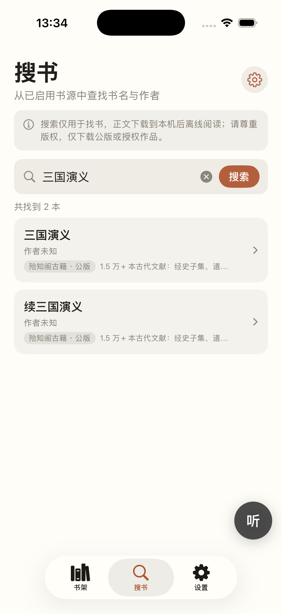

# iRead — 原生 iOS 小说阅读器

纯原生（SwiftUI + TextKit）的中文小说阅读器，支持**看**和**听**，阅读完全离线。内置 Piper 中文神经语音模型，音质接近真人。新增「搜书」功能：从内置书源在线搜索、下载到本机后离线阅读，阅读时没有 App 广告。

> **使用声明：仅供个人学习、禁止传播、禁止批量、看完即删、责任自担。**





## 功能

### 看
- TXT 导入（UTF-8 / GBK 自动识别），文件仅存本机 `Documents/Books/`
- 章节自动识别：`第X章 / 卷X / Chapter N / 序章 / 楔子 / 尾声` 等目录规则，识别失败按固定长度兜底切分
- **阅读方式只有一种：上下连续滑动**（网页式滚动），多章堆叠在同一 `UIScrollView` 里；跳章走菜单「目录」或书签，阅读页没有上一章/下一章按钮
- 排版面板（番茄式底部抽屉）：亮度 + 护眼、字号 + 粗体、背景色、间距/边距、听书，全部一行一控；调字号时上半屏正文仍可见
- **跨章无缝**：滑到章末直接接下一章标题，不会「一章到底就停」；前插章节时等量补偿 `contentOffset`，视觉不跳动
- TextKit 原生渲染（`UITextView`，不走 WebView），中文避头尾（标点不出现在行首）、两端对齐、首行缩进
- **选中就是系统选中**：长按出现放大镜、左右圆形手柄、可拖拽调整范围，复制 / 查询 / 翻译 / 朗读全在系统菜单里 —— 选中框和手感与系统完全一致，不是自绘的假选中
- 排版可调：字号 14–36、行距、段间距、四向边距、粗体；四套主题（纸张 / 羊皮纸 / 护眼 / 夜间）
- 书架：网格 / 列表、搜索、置顶、已读标记、重命名、进度百分比、阅读进度记忆（精确到章内位置）
- **设置只做一个齿轮**：书架右上角的 icon（不带文字、不占标签栏），点开以 sheet 弹出；底部标签栏只有「书架 / 搜书」两项
- 书签：任意位置添加，可跳转、左滑删除

### 听（三种音色，全部离线）
| 音色 | 引擎 | 模型 | 说明 |
|---|---|---|---|
| 女声「花颜」 | Piper VITS（内置） | `zh_CN-huayan-medium` 63MB | 音色自然，中位基频约 214Hz |
| 男声「超文」 | Piper VITS（内置） | `zh_CN-chaowen-medium` 63MB | 青年男声，中位基频约 160Hz |
| 粤语 | 系统 `AVSpeechSynthesisVoice` | `yue-HK` Sinji | 用粤语读音念书面中文，学粤语用 |

- 两个内置模型都经 sherpa-onnx 在本机 CPU 推理，22050Hz；首次加载约 0.5–0.7 秒，之后常驻，切音色不重复加载
- 合成速度约为实时的 6–14 倍，按句流水线合成：第 N 句在播时第 N+1 句已在合成
- **标点停顿**：Piper 逐句独立合成、拼接后本来没有间隙，因此每句结束会按句尾标点补一段静音
  （`。`0.42s、`！？`0.50s、`…`0.55s、`；`0.30s、`：`0.22s、`，、`0.18s、换行 0.55s）
- **逗号也要停顿（两个模型都切）**：Piper 是逐句独立合成，句内标点本身不产生间隙 ——
  男声走词典，标点直接被丢弃；女声走 espeak 虽认标点，但生成时 `silence_scale` 只有 0.2，
  实测逗号处只剩约 60ms 自然换气，听不出停顿。因此两个音色都在逗号/顿号/冒号处切句
  （最短 4 字），靠句尾补静音拿到真实停顿：女声实测 60ms → 329ms
- 阅读页顶部喇叭按钮或书架长按「听书」进入；**按段朗读并自动向下滚动**，跨章连续
- **朗读变色**：正在读的那一句，字本身换成朗读色（不是加底色色块），自动跟随滚动，一眼看出读到哪
- **从这儿读**：长按选中任意文字 → 系统编辑菜单最前面就是「播放」，点它**立刻从选中位置出声**，不弹播放器（正文不被遮住，少一次多余跳转）；复制 / 查询 / 翻译等系统项照常可用。已去掉「点屏幕就开始朗读」：点击位置无法可靠对应到某一块文字，只有先选中才能确定要读哪句
- **续读**：朗读位置只由朗读本身推进 —— 停止后再次开播，从上一次读到的文字位置（段落开头）继续，**不看屏幕当前停在哪**。手动滑动浏览不会改变朗读位置；只有编辑菜单「播放」和「从本页听」会同步它
- **听书与阅读互不干扰**：跳章、跳书签只挪阅读视口，**不会换朗读到那一章、也不会自动开播**，声音照旧念原来的地方；想改从这一章听，点跟读条上的「从本页听」
- **回到朗读位置**：正在听这本时把正文滑到别处看，跟随会自动停下（不再把页面拽回去）；此时底部浮出「回到朗读位置」，一点就回到**当前正在念的那一句**并恢复跟随。它只挪视口、不改朗读进度，也不会重读
- **边听边读**：播放器里点「边听边读」打开真正的阅读页，从朗读位置开始跟读；跟读条上的「返回」随时滚回正在朗读的那一句（和滑开时浮出的「回到朗读位置」是同一个动作）。跟读条自带「听书」入口，一键回到播放器调语速、换音色
- 沉浸模式下方有迷你听书条：播放 / 暂停 / 停止；锁屏与后台可继续播放（`UIBackgroundModes: audio`）
- 语速可调（0.4x – 4.0x，滑杆连续调节，变速不变调），中断处理：来电自动暂停、拔耳机自动暂停

### WiFi 传书
书架右上角「+」→「导入书籍」→「WiFi 传书」开启服务，App 内会显示一个局域网地址（含本次 6 位访问码）。
同一 WiFi 下的电脑/另一台手机用浏览器打开该地址，选 TXT 上传即自动进书架，支持一次选多本、UTF-8/GBK/UTF-16 编码、单本 60 MB 以内。
每次开启服务访问码随机生成，地址泄露也不会被别人误传；传完可在 App 内点「停止」。服务只在本机监听，不连互联网、不扫描其它设备，传书过程不需要外网。

> 传书时需要 iRead 保持在前台；切后台太久系统可能挂起本地服务。

### 搜书与下载（在线找书，离线阅读）
「搜书」标签页可从书源搜索书名，选中后把正文**下载到本机**加入书架，之后走和本地导入完全相同的离线阅读链路 —— 阅读本身不联网。

- **已移除番茄 / 七猫源**（2026-11-21）：七猫网页端只开放前若干章，后段要在七猫 App 内开通会员才给读；番茄重复条目多、章节接口经常挂住（实测单条 25s+ 不返回）。两者对「下载全本」帮助都很小，还会拖慢搜索与章节统计，已从内置书源里去掉。实现代码（`FanqieSource` / `QimaoSource`）保留，需要时把源条目加回 `SourceStore.fallbackSources` 即可。
- **内置公版书源**：殆知阁古籍（1.5 万+ 本经史子集、四大名著、诗词小说、中医典籍）。书目随 App 打包（本地即时搜索、无 API 限流），正文从 jsDelivr/raw CDN 下载，大陆可达。
- **内置笔趣阁源**（`bqg-92xs`，就爱文学）：纯静态 HTML 抓取的书源示例，规则见 `docs/sources/bqg-92xs.json`。站点域名易变，失效时可在书源管理页编辑 host 或导入新规则。
- **内置「阅读」共享书源包**（2026-11-21）：把社区流传的 941 条「阅读 3.0」书源跑了一遍转换器，只有规则能用 CSS 选择器表达的那部分能转（340 条），按站点去重后 314 条，联网三阶段实测（搜索 → 目录 → 正文）最终留下 **9 个稳定可用的静态站**，随 App 打包在 `iRead/Resources/sources_legado.json`。它们大多是笔趣阁同模板站，一本书在不同站点的可下章数差别很大（例如《剑来》在 00小说网 1093 章、其余几家 1311 章），正好用来比「哪个源能下全本」。正文/目录里常见的站点广告（最新网址、天才一秒记住、章节报错提示、「最新章节」区块）已在规则里清掉；站点的域名迁移也一并修正。
- **书源可导入/可编辑**：书源管理页支持粘贴或选择 JSON 导入自定义书源，内置源可禁用；规则格式见下方「书源规则格式」。
- **使用声明**：仅供个人学习、禁止传播、禁止批量、看完即删、责任自担。本项目自带内容均为公版/原创；第三方书源（含笔趣阁）仅提供抓取能力，内容来源由使用者自行判断并承担相应责任。该声明在书籍详情页与设置页常驻；搜书页首次进入时完整展示，搜索后收进顶栏的 ⓘ 按钮（点开即看），把屏幕让给结果列表。
- **边下边读**：点「下载全书」后书**立即进入书架**（占位），正文分批抓取、抓完一批写一批 —— 下几章就能先读几章，不必等整本下完。进度直接显示在书架封面与「下载任务」页，可随时**暂停 / 继续 / 取消**，取消保留已下章节。下载完成后自动跳到书架。
- **多书源并发搜索**：每个启用的书源各起一个任务同时搜，谁先回来谁先上屏；单源 12 秒超时，某个源挂掉或超时不会拖住其它源（结果按书源顺序稳定排列）。
- **结果直接标章节数**：每条结果在后台查目录并显示「可下 87/1279 章」「共 1312 章」这类规模，查询最多 3 并发、滚到哪查到哪，不会一次性把书源打满。「目录为空」（占位书/已下架）与「无可下载章」（有目录但一章正文都拿不到）分开标注。
- **同名书按源并列**：同名条目聚在同一区块，作者一致的标「同名书 · N 个源都有」，作者不同的提示「作者不同请核对」；可下章数最多的那条标「章节最多」，选源下载时一眼能比。
- **一键按章节数排序**：搜索结束后点右上角「章节最多」，结果按**可下章数**从多到少重排（组内也按章数排，同名书仍挨在一起）。排序是手动动作、只在搜索完成后可用：搜索过程中结果还在陆续回来，此时不重排。点下后立刻按已知章数排序，没查到的先沉底、查到就归位，顶部显示「正在统计章节…还剩 N 本」；单条请求 6 秒上限，即使某个源挂住也不会把整批拖死。
- **下不了的自动过滤**：目录为空、或确认一章正文都拿不到的条目默认隐藏，顶部显示「共 X 本可下载，已隐藏 Y 本」，点「显示全部」可回看被隐藏的条目。章节数查询失败（网络抖动 / 书源风控）只标「章数未知」并重试一次，不会把能下的书误删。
- 批内并发抓章（4 并发），按章序回填保证正文不乱序；下载中的书点开照常阅读已落盘章节。

> 在线环节只有「搜索 + 下载」。正文落盘后，阅读/听书/排版全部离线，与本项目一贯的离线定位一致。

### 内置内容
三本**原创**演示小说（共 21 章约 1.4 万字）：《檐下晚晴》（都市温情）、《潮汐档案馆》（近未来科幻）、《青灯渡异录》（古典志怪）。首次启动自动灌入书架，可删除。

#### 书源规则格式（自定义书源）
一个书源是一个 JSON 对象（或数组），核心字段：

```json
{
  "id": "my-source",
  "name": "我的书源",
  "host": "https://example.com",
  "type": "html",
  "search": {
    "url": "https://example.com/search?key={key}",
    "list": "class(book-item)",
    "fields": {
      "title": "tag(a).text",
      "author": "class(author).text",
      "url": "tag(a).attr(href)"
    }
  },
  "chapter": {
    "url": "{url}",
    "list": "class(chapter-list).tag(a)",
    "fields": { "title": "text", "url": "attr(href)" }
  },
  "content": {
    "url": "{url}",
    "list": "id(content).text"
  }
}
```

- 占位符：`{key}` 关键词、`{url}` 上一步的链接、`{host}` 站点主页、`{page}` 页码。
- 选择器用点链式 DSL（纯 Foundation 实现，无需第三方库）：`tag(x)` / `class(x)` / `id(x)` / `attr(x)` / `re('正则',组号)` / `text` / `entity` / `trim` / `replace('a','b')` / `drop('正则')` / `skip(n)` / `nth(n)` / `first` / `last` / `join('分隔符')` / `json(路径)`。
- `skip(n)` 跳过前 n 项，用来去掉表格表头、「↓直达页面底部↓」这类干扰行；`cleanTail` 里可以用同一套算子对每段正文做清洗（例如 `replace('最新网址：\\S+','')`）。
- `type: "json"` 时，`list` 与 `fields` 的值改为 JSON 键路径（如 `data.books[*]`、`title`）。
- `content` 支持 `page` 分页（`start`/`max`/`step`）与 `join` 拼接符。
- 搜索结果是**先按详情页地址去重、再按关键词过滤**（书名或作者含关键词），单源最多取 30 条 —— 模板站的搜索页会把同分类推荐一起返回，不过滤的话多书源会把要找的书淹没；一条都没命中时退回完整列表，不会把作者名/别名搜索过滤成空。
- 内置的 GitHub 公版源用专用 `kind: "github"`，不走通用规则解析。

### 书源工具（`tools/`）

两个脚本都是「一次性研究 + 可复跑」，不参与 App 构建：

```bash
# 1) 把「阅读 3.0」共享书源批量转成 iRead 规则，并打印跳过原因统计
python3 tools/legado-import/convert.py shareBookSource.json /tmp/iread-legado.json

# 2) 用 App 真实选择器引擎做联网三阶段自检（搜索 → 目录 → 正文），不依赖模拟器
swiftc -O -parse-as-library iRead/Models/NovelModels.swift \
  iRead/Services/SelectorEngine.swift iRead/Services/WebText.swift \
  iRead/Services/NovelHTTPClient.swift tools/legado-verify/*.swift -o /tmp/legado-verify
/tmp/legado-verify /tmp/iread-legado.json 剑来 /tmp/report.json
```

`legado-verify` 直接编译 App 里的 `SelectorEngine` / `WebText` / `NovelHTTPClient`，验证结果与真机一致，
不会出现「Python 模拟能跑、App 跑不通」的偏差；`report.json` 里会带上每条的章节数、正文长度与首尾片段。

## 工程结构

```
iRead/
  App/          iReadApp、ContentView（Tab：书架 / 搜书；设置由书架右上角齿轮弹出）
  Models/       Models（Book/Chapter/Bookmark/主题/音色档位）、ReaderSettings
  Models/       NovelModels（书源规则/SearchResult/章节/下载任务）、ReaderSettings（原有）
  Services/     TextParser（编码+分章）、LibraryStore（书库）、
                WiFiTransferServer（局域网传书 HTTP 服务）、
                BookContent（章节定位）、ChapterTextProvider（按章生成排版用的 NSAttributedString）、
                ChapterScroller（TextKit 单章文字视图 + 连续滚动容器）、
                PiperSynthesizer（sherpa-onnx 本地语音封装，双模型）、
                SpeechService（听书调度：双引擎 + 逐句流水线 + 标点停顿）、
                SampleBooks（内置原创示例）
                网络搜书：WebText（HTML 清洗）、NovelHTTPClient（请求）、
                SelectorEngine（选择器 DSL）、NovelFetcher（抓取）、
                GitHubBookSource（内置公版书源）、FanqieSource / QimaoSource（已停用，保留）、
                NovelDownloadManager（下载入库）、
                SourceStore（书源仓库）、AccountStore（登录 Cookie，Keychain）
  Resources/    sources_legado.json（「阅读」共享书源转换出的 9 个静态站，随包内置）
tools/
  legado-import/convert.py         「阅读 3.0」书源 → iRead 规则的批量转换器
  legado-verify/                   macOS 命令行自检（复用 App 选择器引擎联网跑三阶段）
Vendor/booklists/  殆知阁 1.5 万本公版书目（随包，本地搜索）
  Views/        Bookshelf、Import、Reader、ChapterList、ReaderSettings、Bookmarks、Settings
                NovelSearch（搜书）、NovelDetail（详情/下载）、SourceManager（书源管理）、
                DownloadTasks（下载任务）、AccountLogin（内置网页登录）
Vendor/
  SherpaOnnxC.xcframework          sherpa-onnx v1.13.8（含 onnxruntime，动态框架）
  piper/                           语音资源根目录（folder reference，保留目录结构）
    huayan/                        zh_CN-huayan-medium.onnx + tokens.txt（女声，走 espeak）
    chaowen/                       zh_CN-chaowen-medium.onnx + tokens.txt + lexicon.txt
                                   + phone/number/date.fst（男声，走词典）
    espeak-ng-data/                cmn/en 词典（仅女声用，18MB → 3.2MB）
Support/
  Info.plist    UIBackgroundModes=audio（与生成的 Info.plist 合并）
docs/screenshots/      运行截图
```

### 关于语音模型的版本选择

`sherpa-onnx` 从 **v2.0.0** 起移除了 espeak 前端（`data_dir` 标注 `@deprecated Ignored since v2.0.0`），
而 Piper 中文模型必须靠 espeak 做 `cmn` 音素化，因此固定使用 **v1.13.8**。

iOS 包必须选 `ios-shared-onnxruntime-static` 这一款：`ios-static` 变体不含 onnxruntime，
链接时会报 `Undefined symbols: _OrtGetApiBase`。前者是动态框架、onnxruntime 已静态内置，
需要以 **Embed & Sign** 方式嵌入 App。

### 语音模型的三个坑（都实测踩过）

1. **int8 / fp16 量化版不能用**。`chaowen-int8` 会静默卡死，`chaowen-fp16` 直接崩：
   ```
   Ort::Exception: Type (tensor(float16)) of output arg does not match expected type (tensor(float))
   ```
   sherpa-onnx iOS 的 onnxruntime 静态构建是纯 CPU fp32，只认原始 fp32 模型。
2. **词典模型和 espeak 模型不能共用一套配置**。C API 明确规定 `lexicon` 在提供 `data_dir` 时被忽略，
   配错会在 `SherpaOnnxCreateOfflineTts` 里抛 C++ 异常直接 abort（不是返回 nil，无法用 `guard` 兜住）。
   花颜走 `data_dir`，超文走 `lexicon`。
3. **iOS 没有任何中文男声**。实测 `AVSpeechSynthesisVoice.speechVoices()` 里中文只有
   `zh-CN Tingting`、`zh-TW Meijia`、`yue-HK Sinji`，全是女声。
   所以「男声」必须靠内置模型，不能指望系统语音。

### 排版的坑（TextKit 1 单章 `UITextView`）

1. **`attributedText` 赋值会把 `textContainer.size` 按 `bounds` 重置**。视图还是 `.zero` 时容器高度变 0，
   只排出十几行，`usedRect` 只有真实高度的 1/3，整章后半段被裁掉（朗读高亮还会落在没渲染的字上，
   看起来就像「读的内容和屏幕对不上」）。所以赋值后要**重钉容器尺寸**再 `ensureLayout`：
   ```swift
   attributedText = attributed
   layoutManager.allowsNonContiguousLayout = false
   textContainer.size = CGSize(width: width, height: 100_000)
   layoutManager.ensureLayout(for: textContainer)
   ```
   实测 731 字的章：修复前 `usedRect` 688pt（17 行），修复后 2301pt（55 行），与 `sizeThatFits` 一致。
2. **`widthTracksTextView` / `heightTracksTextView` 必须关**，否则 `sizeThatFits` 会把高度截断。
3. **`isScrollEnabled = false` + 自己算高度** 是单章整块渲染的正确组合；不要指望 `intrinsicContentSize`。

## 构建与运行

要求：Xcode 26.5+（iOS 26.5 SDK）、iOS 17.0+ 真机或模拟器。

```bash
# 模拟器
xcodebuild -project iRead.xcodeproj -scheme iRead \
  -destination 'platform=iOS Simulator,name=iPhone 17' build

# 真机一键构建 + 签名 + 安装 + 启动
./scripts/install-device.sh
```

真机签名使用 team `8VM4LPD9YP`，`xcodebuild` 需带 `-allowProvisioningUpdates` 自动生成描述文件。

```bash
# 打成 IPA，导进 iPhone 上的 SideStore（手机端自己续签）
./scripts/make-ipa.sh            # → dist/iRead.ipa

# 电脑在手边时的兜底：剩余 <48h 才重装
./scripts/auto-refresh.sh
```

免费 Apple ID 的**描述文件**只有 7 天（开发证书是 1 年，两回事），到期 App 打不开但数据不丢。
三条续签路线的取舍、SideStore 一次性设置步骤、iOS 26.4+ 的 remote pairing 坑，见
[**docs/签名与续期.md**](docs/签名与续期.md)。设置 → 关于 里也能直接看到剩余天数。

## 调试参数（仅自动化截图/自检用，正常使用不涉及）

- `--debug-search`：启动后切到搜书页
- `--search-key 红楼梦`：搜书页自动填入关键词并搜索（配 `--debug-search`）
- `--search-source bqg-92xs`：只搜指定书源（单独验证/截图某个源）
- `--show-unavailable`：不过滤「下不了」的结果，用于核对被隐藏的条目
- `--debug-sources`：直接打开书源管理页（核对账号登录区）
- `--debug-login <site>`：直接弹出对应站点的登录页（当前没有启用任何登录站点，留作备用）
- `--sort-chapters`：搜索结束后自动点一次「章节最多」排序（模拟用户操作，截图用）
- `--search-log`：打印每个书源的搜索耗时与命中数（排查慢源、挂掉的源）
- `--download-selftest 红楼梦`：跑一遍「搜索→详情→下载→入库」全链路并打印日志
- `--selftest-source bqg-92xs`：配合上一项，指定要测试的书源 id（默认测第一个 GitHub 源）
- `--debug-reader`：启动后直接打开第一本书
- `--debug-settings`：启动后直接弹出设置页（与书架齿轮同一入口）
- `--scroll-mid`：直接定位到章中 45%
- `--scroll-end`：定位到章末（验证跨章衔接）
- `--voice female|male|cantonese`：指定音色档位
- `--listen`：打开书后自动开始听书
- `--immersive`：进入沉浸模式（隐藏工具栏）
- `--night`：临时切夜间主题
- `--expand-prefs` / `--prefs-scroll-speech`：设置页展开并滚动到指定分区
- `--tts-selftest`：跑一遍本地语音自检，打印模型加载耗时、每句合成耗时、基频、标点静音长度、
  断句结果与播放链路是否走通（`--male-only` / `--female-only` 可只测单个模型）
- `--list-voices`：打印系统全部语音清单（确认中文男声/粤语是否真的存在）

粤语（系统语音）专用自检。真机拿不到 stdout，所以结果都落盘到 App 沙盒的 `Documents/`，
用 `xcrun devicectl device copy from --device <UDID> --domain-type appDataContainer \
--domain-identifier com.yingyang.iread --source Documents/<文件名> --destination .` 取回：

- `--yue-selftest`：跑粤语播放链路，逐秒采样 `isActive/isPaused/isSpeaking/engine/字符区间`，
  8 秒内区间不动就记 `⚠️ STALL`；可验证多段自动连播 → `Documents/yue-selftest.txt`
- `--yue-selftest --yue-long`：改用约 260 字的真实长度整段（与听书切段一致），验证长段不中断
- `--yue-control`：专测控制链路 —— +3s 暂停、+8s 继续、+11s 改语速、+15s 停止，
  每秒打印 `synth[speaking/paused]` 与 SpeechService 的 `isPaused`，看两边是否一致 → `yue-control.txt`
- `--yue-restart`：专测「打断重播」（等价于改语速 / 切章 / 换音色），每 4 秒打断一次并重播，
  统计 `spuriousAdvances`。修复前每次打断都会误触发一次 `onAdvance`（正文往前蹦一段），
  修复后应为 **0** → `yue-restart.txt`
- `--yue-pipeline`：走**真实听书链路**（真书、真切段、真按钮）复现用户操作：
  播放 → 暂停 → 暂停中改语速 → 继续 → 再暂停 → 继续 → 停止。判断标准：暂停期间
  正文位置不许自己往前跑；改语速后从**当前句**用新语速重读，不许跳到下一段；
  每次「继续」都真的出声 → `yue-pipeline.txt`

## 开源协议

本项目以 **MIT License** 开源，全文见 [LICENSE](LICENSE)：可自由使用、修改、分发，保留版权声明即可。

几点说明：

- **仓库里没有任何书籍正文**。`Vendor/booklists` 只是公版书目索引（书名 + 仓库内路径），正文由 App 运行时按需从公开 CDN 下载；第三方书源规则是抓取模板，内容来源与使用责任由使用者自行判断。
- 第三方组件遵循各自许可：sherpa-onnx（Apache-2.0）、Piper 中文语音模型（huayan / chaowen，许可见模型发布页）、殆知阁书目索引（[garychowcmu/daizhigev20](https://github.com/garychowcmu/daizhigev20)）。
- 仅供个人学习研究，请勿用于商业分发或批量抓取。
